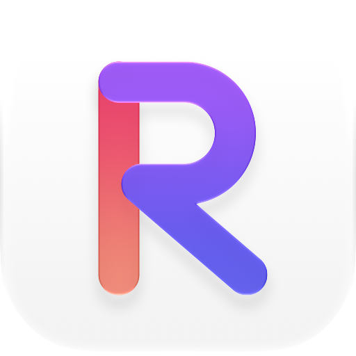
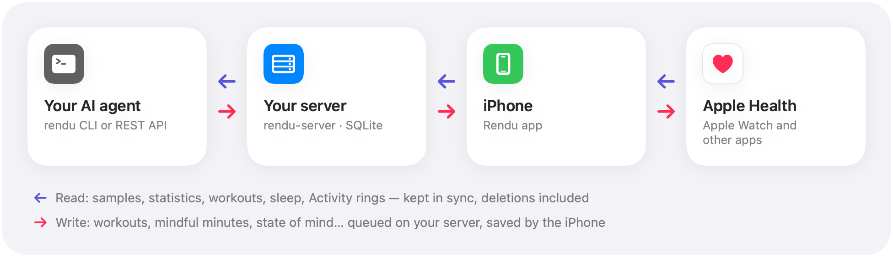
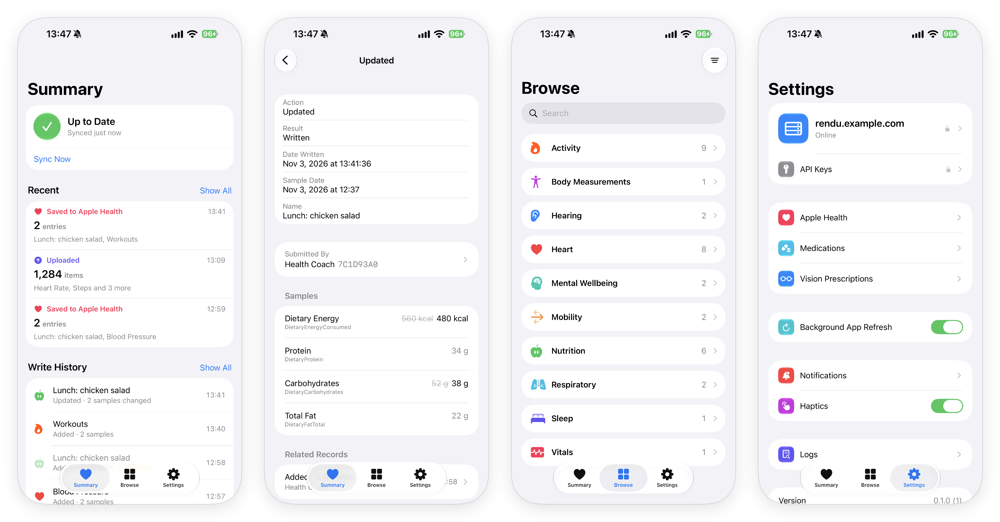

<p align="center">
  <picture>
    <source media="(prefers-color-scheme: dark)" srcset="docs/images/logo-dark.png">
    
  </picture>
</p>

<h1 align="center">Rendu</h1>

<p align="center"><strong>Apple Health as a read/write API for your AI agent.</strong></p>

<p align="center">English · <a href="README.zh-CN.md">简体中文</a></p>

<p align="center">

[](https://github.com/Kadxy/rendu/actions/workflows/ci.yml)
[](https://github.com/Kadxy/rendu/releases)
[](LICENSE)

</p>

Apple Health has no web API. Your data lives on your iPhone, and only an app running there can read it or add to it.

Rendu is that app, plus a small server you host yourself:

- **Read:** the iPhone app keeps your Apple Health data synced to your server. An AI agent, or any script of yours, reads it through a REST API or the `rendu` CLI.
- **Write:** what the agent submits is saved to Apple Health by the iPhone, and shows up in the Health app like any other entry.

<picture>
  <source media="(prefers-color-scheme: dark)" srcset="docs/images/architecture-dark.png">
  
</picture>

## What you can do with it

- **Ask about your health.** "How did I sleep this week?" "Is my resting heart rate going up?" The agent reads sleep stages, heart rate, HRV, steps, workouts and Activity rings, with daily or hourly statistics that match the Health app.
- **Let the agent log things for you.** A workout, mindful minutes, a mood, a symptom, a blood pressure reading: whatever you tell it is saved to Apple Health.
- **React to new data.** The change feed can wait for the next upload, such as a workout you just finished. It works like `HKObserverQuery` over HTTP.
- **Fix mistakes.** Any entry the agent wrote can be updated or deleted later. Nothing else in Apple Health can be changed through Rendu.

<p align="center">
  
</p>

## How it works

- **Apple Health is the source of truth.** The server keeps a copy that follows Apple Health, deletions included. If you delete an entry in the Health app, it disappears from the API too.
- **Sync is incremental.** The app runs one `HKAnchoredObjectQuery` per type. The first import uploads your entire history, which takes a few minutes even for 1,000,000+ samples. After that, only what changed is uploaded.
- **Statistics come from the phone.** They're computed with `HKStatisticsCollectionQuery`, so sources are deduplicated the way the Health app does it.
- **Writes are queued.** A write starts as `pending` and ends as `written`, `failed` or `conflict`.
  - While the app is open, writes are saved within seconds.
  - Otherwise they're saved the next time the iPhone syncs (see [Limitations](#limitations)).
  - Each entry keeps a sync identifier, so the agent can replace or delete it later.
- **Names come from HealthKit.** The API uses HealthKit's type identifiers, `HKUnit` strings and statistics options. `rendu schema` (`GET /v1/schema`) returns exact definitions, so an agent doesn't have to guess. They come from three places:
  - the iOS SDK headers;
  - what your iPhone supports;
  - the JSON format the server validates writes against.
- **Every write is visible in the app.** Write History shows each write, who submitted it and what became of it, with updates shown against the values they replaced. Summary shows what each sync did.

## What's supported

|  | Read | Write |
|---|:---:|:---:|
| Quantities: steps, heart rate, HRV, energy, distance, nutrients… (120 types) | ✓ | ✓ |
| Categories: sleep, mindful minutes, symptoms, cycle tracking… (71 types) | ✓ | ✓ |
| Blood pressure and food (correlations) | ✓ | ✓ |
| Workouts, with routes, samples, events and effort | ✓ | ✓ |
| State of mind, audiograms, GAD-7 / PHQ-9, heartbeat series | ✓ | ✓ |
| Vision prescriptions, shared one by one as iOS asks | ✓ | ✓ |
| ECG, medications and doses, Activity rings, characteristics (date of birth, blood type…) | ✓ | — |
| Health Records (clinical), CDA documents | — | — |

A dash in the Write column means HealthKit doesn't let apps create that kind of data. The full table is in [docs/PROTOCOL.md](docs/PROTOCOL.md#read-and-write-capabilities).

## Getting started

You need:

- An iPhone on iOS 27.
- A Mac with Xcode 27. A free Apple ID is enough.
- A server with Docker and a domain for HTTPS.

### 1. Run the server

```bash
git clone https://github.com/Kadxy/rendu.git && cd rendu/deploy
docker compose up -d --build
```

There are no secrets to configure. The server listens on `127.0.0.1:8787` (set `RENDU_PORT` to change it).

For HTTPS, either:

- point your reverse proxy or Cloudflare Tunnel at it, or
- put your domain in `Caddyfile` and run `docker compose --profile caddy up -d --build`. Caddy gets a certificate for you, which needs ports 80 and 443 open.

### 2. Install the iPhone app

```bash
brew install xcodegen
cd ios
cp Local.xcconfig.example Local.xcconfig   # your team ID, and a bundle ID of your own
xcodegen generate
open Rendu.xcodeproj                         # choose your iPhone, then Run
```

With a free Apple ID the app is signed for 7 days. Rendu reminds you the day before it expires. Run it again from Xcode and your data is kept.

### 3. Pair the iPhone with the server

Enter your server's address in the app. The app shows a pairing code. Within 5 minutes, run this on the server:

```bash
docker compose exec rendu rendu-server pair 123456   # the code the app shows
```

Then allow access to Apple Health, and keep the app open until the first import finishes.

A server pairs with one iPhone. Pairing another one replaces it. The iPhone's key is generated on the phone and never shown, not even in the server's output or logs.

### 4. Give your agent a key and the CLI

To create a key, open the app and go to **Settings → API Keys → Create API Key…**.

- Choose **Read Only** or **Read & Write**.
- The key is shown only once.
- You can revoke it at any time.
- Each key has its own activity log in the app.

Install the CLI on the machine your agent runs on (macOS or Linux):

```bash
curl -fsSL https://raw.githubusercontent.com/Kadxy/rendu/main/install.sh | sh
```

Other ways to install:

- **Windows:** download the archive from [Releases](https://github.com/Kadxy/rendu/releases).
- **With Go:** `go install github.com/Kadxy/rendu/cmd/rendu@latest`.

Later, `rendu update` updates it in place.

```bash
export RENDU_URL=https://rendu.example.com
export RENDU_API_KEY=rdk_...

rendu status
```

Then give your agent [docs/AGENT.md](docs/AGENT.md), the usage guide written for agents. It covers what to read, how to write each kind of entry, and what to do when a write fails. It's in Chinese, which language models read without trouble.

## The CLI

```bash
rendu samples HKCategoryTypeIdentifierSleepAnalysis --since 1d             # last night's sleep stages
rendu stats HKQuantityTypeIdentifierStepCount --interval day --since 7d     # steps per day
rendu stats HKQuantityTypeIdentifierRestingHeartRate --since 30d            # resting heart rate
rendu changes --anchor "$ANCHOR" --wait 60                                 # wait for what changes next
rendu schema HKCategoryTypeIdentifierMindfulSession                        # its values, rules and an example

# Log 10 mindful minutes
echo '{"kind":"category","type":"HKCategoryTypeIdentifierMindfulSession",
  "startDate":"2026-11-01T07:30:00+08:00","endDate":"2026-11-01T07:40:00+08:00",
  "value":0}' | rendu write save

rendu write list --status pending
```

- **Output:** JSON on stdout.
- **Errors:** one line on stderr, with a non-zero exit code. A mistyped type name gets a suggestion instead of an empty result.
- **Help:** `rendu help <command>` lists a command's flags.

## The REST API

Every request carries an API key. Everything is JSON.

```bash
curl -H "Authorization: Bearer $RENDU_API_KEY" \
  "$RENDU_URL/v1/samples?type=HKQuantityTypeIdentifierHeartRate&start=2026-11-01T00:00:00Z"
```

The API includes:

- samples and statistics
- Activity rings
- a change feed, with long polling
- writes and their status
- schema definitions

The full contract is in [docs/PROTOCOL.md](docs/PROTOCOL.md).

## Security and privacy

- **Your data stays on your server.** Rendu has no cloud service, accounts or analytics.
- **Credentials are hashed.** The server stores only SHA-256 hashes of keys, and its configuration contains no secrets.
- **Each credential has a scope.** The paired iPhone uploads data and runs writes. API keys are Read Only or Read & Write.
- **The iPhone's key stays on the phone.** It's a file in the app's container. It's never displayed and isn't included in backups.
- **Apple Health permissions decide what Rendu can read and write.** You change them in the Health app. Rendu's **Settings → Apple Health** shows which types are off.
- **Server settings can be locked.** An optional Face ID lock protects them in the app.
- **The database isn't encrypted at rest.** Keep the server private (the database file is mode 600), and back it up with something that encrypts, such as restic or age.

## Limitations

- **Not on the App Store.** You build the app yourself. With a free Apple ID it needs re-signing every 7 days, and there are no push notifications.
- **Nothing syncs while the iPhone is locked.** HealthKit data is encrypted while the iPhone is locked, so Rendu catches up on the next unlock.
- **iOS rations background work.** With the app open, writes are saved within seconds. Otherwise they wait until the next unlock, the next time you open the app, or a background wake-up, which iOS allows only now and then.
- **iOS doesn't tell apps what they may read.** Rendu infers it: a type that used to have data from other sources and now has none probably had reading turned off.
- **Apple Health only.** Rendu doesn't support Android, Google Fit or Health Connect.

## FAQ

**Why not use the Health app's "Export All Health Data"?**
That's a one-time XML archive. Rendu stays up to date, includes deletions, gives you statistics that match the Health app, and can write back.

**Does it work with ChatGPT, Claude or other agents?**
It works with anything that can run a command or make an HTTP request. There's no MCP server yet.

**Can the agent change data from other apps?**
No. An agent can only update or delete entries Rendu saved.

## Development

| Directory | Contents |
|---|---|
| `ios/` | iPhone app (Swift, SwiftUI, HealthKit) |
| `cmd/rendu-server`, `internal/server`, `internal/store` | Server (Go, SQLite without cgo) |
| `cmd/rendu`, `internal/cli` | CLI |
| `internal/schema` | HealthKit definitions generated from the SDK headers |
| `deploy/` | Docker Compose and Caddy |

```bash
make test   # go vet + go test
make lint   # golangci-lint and swift-format
make fmt
make schema # regenerate internal/schema/healthkit.json after an SDK update
```

To release the CLI, push a `vX.Y.Z` tag. GitHub Actions builds macOS, Linux and Windows binaries with GoReleaser.

## The name

*Rendu* (任督) comes from the Chinese saying *打通任督二脉*: to open the Ren and Du meridians, the two channels that, once connected, let everything flow. In Chinese the app is called 任督.

## License

[AGPL-3.0](LICENSE). The iPhone app's sync core is forked from [pulso](https://github.com/lenilsonjr/pulso) (MIT, see `ios/LICENSE-pulso`).
