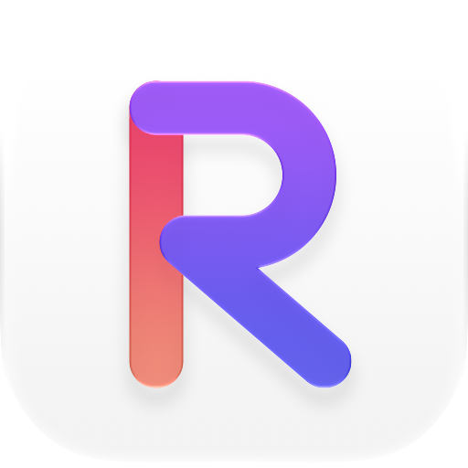
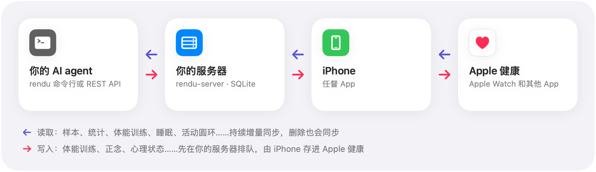
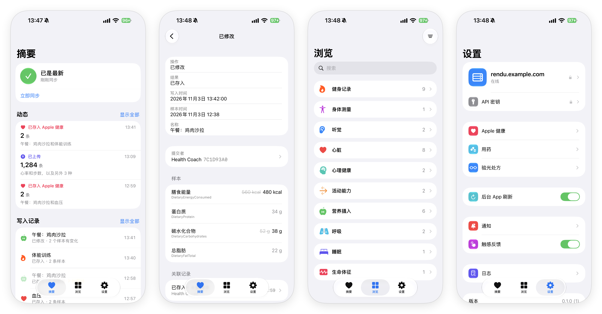

<p align="center">
  <picture>
    <source media="(prefers-color-scheme: dark)" srcset="docs/images/logo-dark.png">
    
  </picture>
</p>

<h1 align="center">任督 Rendu</h1>

<p align="center"><strong>把 Apple 健康（Apple Health / HealthKit）变成 AI agent 可以读写的 API。</strong></p>

<p align="center"><a href="README.md">English</a> · 简体中文</p>

<p align="center">

[](https://github.com/Kadxy/rendu/actions/workflows/ci.yml)
[](https://github.com/Kadxy/rendu/releases)
[](LICENSE)

</p>

Apple 健康没有网页 API。健康数据只在你的 iPhone 上，只有装在 iPhone 上的 App 能读取或写入。

任督就是这样一个 App，再加上一台你自己部署的服务器：

- **读取：** iPhone App 把 Apple 健康的数据持续同步到你的服务器。AI agent 或你自己的脚本通过 REST API 或 `rendu` 命令行读取。
- **写入：** agent 提交的记录由 iPhone 存进 Apple 健康，在“健康”App 里和其他记录一样显示。

<picture>
  <source media="(prefers-color-scheme: dark)" srcset="docs/images/architecture-zh-CN-dark.png">
  
</picture>

## 能用来做什么

- **问自己的健康状况。** 比如“这周睡得怎么样？”“静息心率是不是在升高？”agent 能读到睡眠阶段、心率、心率变异性（HRV）、步数、体能训练和活动圆环，还有按天或按小时的统计，数字和“健康”App 一致。
- **让 agent 帮你记录。** 一次体能训练、几分钟正念、一次心情、一个症状、一次血压测量，你告诉它，它就存进 Apple 健康。
- **对新数据做出反应。** 变更流（change feed）可以等待下一次上传，比如刚结束的一次体能训练。相当于 HTTP 上的 `HKObserverQuery`。
- **改正错误。** agent 写入的任何记录之后都能修改或删除。通过任督改不了 Apple 健康里的其他数据。

<p align="center">
  
</p>

## 工作方式

- **以 Apple 健康为准。** 服务器上的数据跟着 Apple 健康走，删除也会同步。你在“健康”App 里删掉一条记录，API 里也就没有了。
- **增量同步。** App 对每种类型运行一个 `HKAnchoredObjectQuery`。第一次导入会上传全部历史，87 万条样本也只要几分钟。之后只上传有变化的部分。
- **统计在手机上算。** 用 `HKStatisticsCollectionQuery` 计算，和“健康”App 一样对多个数据来源去重。
- **写入先排队。** 一条写入从 `pending` 开始，最后是 `written`、`failed` 或 `conflict`。
  - App 开着时，几秒内存进 Apple 健康。
  - 否则等 iPhone 下一次同步时执行（见[已知限制](#已知限制)）。
  - 每条记录都有同步标识（sync identifier），agent 之后可以替换或删除它。
- **沿用 HealthKit 的名称。** API 用 HealthKit 的类型标识符、`HKUnit` 单位字符串和统计选项。`rendu schema`（`GET /v1/schema`）返回准确的定义，agent 不用猜。定义来自三处：
  - iOS SDK 头文件；
  - 你这台 iPhone 支持什么；
  - 服务器校验写入时用的 JSON 格式。
- **每次写入在 App 里都看得到。** “写入记录”列出每次写入、由谁提交、结果如何，修改会和它替换掉的值对比显示。摘要页的“动态”列出每次同步做了什么。

## 支持的数据

|  | 读取 | 写入 |
|---|:---:|:---:|
| 数量类型：步数、心率、HRV、能量、距离、营养素……（120 种） | ✓ | ✓ |
| 分类类型：睡眠、正念、症状、经期追踪……（71 种） | ✓ | ✓ |
| 血压和食物（关联对象） | ✓ | ✓ |
| 体能训练，含路线、附带样本、事件和运动强度 | ✓ | ✓ |
| 心理状态、听力图、GAD-7 / PHQ-9 量表、心跳序列 | ✓ | ✓ |
| 验光处方（按 iOS 的要求逐条共享） | ✓ | ✓ |
| 心电图、用药和服药记录、活动圆环、个人特征（出生日期、血型……） | ✓ | — |
| 健康记录（临床数据）、CDA 文档 | — | — |

写入一栏是“—”的，表示 HealthKit 不允许 App 创建这类数据。完整的表在 [docs/PROTOCOL.md](docs/PROTOCOL.md#read-and-write-capabilities)。

## 开始使用

你需要：

- 一台 iOS 27 的 iPhone。
- 一台装有 Xcode 27 的 Mac。免费的 Apple ID 就够。
- 一台装了 Docker 的服务器，和一个用于 HTTPS 的域名。

### 1. 部署服务器

```bash
git clone https://github.com/Kadxy/rendu.git && cd rendu/deploy
docker compose up -d --build
```

不用配置任何密钥。服务器监听 `127.0.0.1:8787`（用 `RENDU_PORT` 修改）。

HTTPS 二选一：

- 把你的反向代理或 Cloudflare Tunnel 指向它；或者
- 把你的域名写进 `Caddyfile`，运行 `docker compose --profile caddy up -d --build`。Caddy 会自动申请证书，需要开放 80 和 443 端口。

### 2. 安装 iPhone App

```bash
brew install xcodegen
cd ios
cp Local.xcconfig.example Local.xcconfig   # 填入你的 team ID，和一个你自己的 bundle ID
xcodegen generate
open Rendu.xcodeproj                         # 选择你的 iPhone，然后 Run
```

用免费 Apple ID 签名的 App 有效期 7 天。到期前一天任督会提醒你，用 Xcode 再 Run 一次就行，数据会保留。

### 3. 配对 iPhone 和服务器

在 App 里填写服务器地址，App 会显示一个配对码。5 分钟内在服务器上运行：

```bash
docker compose exec rendu rendu-server pair 123456   # 换成 App 显示的配对码
```

然后允许访问 Apple 健康，保持 App 打开，直到第一次导入完成。

一台服务器只配对一台 iPhone，配对新的会替换旧的。iPhone 的密钥在手机上生成，从不显示，也不会出现在服务器的输出和日志里。

### 4. 给 agent 一个密钥和命令行

在 App 里打开 **设置 → API 密钥 → 创建 API 密钥…** 创建密钥：

- 选择 **只读** 或 **读与写**。
- 密钥只在创建时显示一次。
- 随时可以撤销。
- 每个密钥在 App 里都有自己的活动记录。

在 agent 运行的机器上安装命令行（macOS 或 Linux）：

```bash
curl -fsSL https://raw.githubusercontent.com/Kadxy/rendu/main/install.sh | sh
```

其他安装方式：

- **Windows：** 从 [Releases](https://github.com/Kadxy/rendu/releases) 下载压缩包。
- **用 Go：** `go install github.com/Kadxy/rendu/cmd/rendu@latest`。

之后用 `rendu update` 原地更新。

```bash
export RENDU_URL=https://rendu.example.com
export RENDU_API_KEY=rdk_...

rendu status
```

然后把 [docs/AGENT.md](docs/AGENT.md) 交给你的 agent。这是写给 agent 的使用说明，讲了该读什么、每种记录怎么写、写入失败时怎么办。

## 命令行

```bash
rendu samples HKCategoryTypeIdentifierSleepAnalysis --since 1d             # 昨晚的睡眠阶段
rendu stats HKQuantityTypeIdentifierStepCount --interval day --since 7d     # 每天的步数
rendu stats HKQuantityTypeIdentifierRestingHeartRate --since 30d            # 静息心率
rendu changes --anchor "$ANCHOR" --wait 60                                 # 等待接下来的变化
rendu schema HKCategoryTypeIdentifierMindfulSession                        # 取值、规则和示例

# 记录 10 分钟正念
echo '{"kind":"category","type":"HKCategoryTypeIdentifierMindfulSession",
  "startDate":"2026-11-01T07:30:00+08:00","endDate":"2026-11-01T07:40:00+08:00",
  "value":0}' | rendu write save

rendu write list --status pending
```

- **输出：** stdout 上的 JSON。
- **出错：** stderr 上一行说明，退出码非 0。类型名写错时会提示最接近的类型，而不是返回空结果。
- **帮助：** `rendu help <命令>` 列出该命令的参数。

## REST API

每个请求都带 API 密钥，请求和响应都是 JSON。

```bash
curl -H "Authorization: Bearer $RENDU_API_KEY" \
  "$RENDU_URL/v1/samples?type=HKQuantityTypeIdentifierHeartRate&start=2026-11-01T00:00:00Z"
```

API 包括：

- 样本和统计
- 活动圆环
- 变更流（支持长轮询）
- 写入和写入状态
- 定义查询（schema）

完整的接口约定见 [docs/PROTOCOL.md](docs/PROTOCOL.md)。

## 安全和隐私

- **数据只在你自己的服务器上。** 任督没有云服务、没有账号，也不收集任何统计数据。
- **凭据只存哈希。** 服务器只保存密钥的 SHA-256 哈希，配置里没有任何密钥。
- **每个凭据都有权限范围。** 配对的 iPhone 负责上传数据和执行写入；API 密钥分只读和读与写。
- **iPhone 的密钥只在手机上。** 它是 App 容器里的一个文件，从不显示，也不进备份。
- **Apple 健康的权限决定任督能读写什么。** 在“健康”App 里修改。任督的 **设置 → Apple 健康** 会列出哪些类型被关掉了。
- **服务器设置可以加锁。** 在 App 里可以开启面容 ID 锁来保护它们。
- **数据库没有加密存储。** 别让外人访问服务器（数据库文件权限是 600），备份时用会加密的工具，比如 restic 或 age。

## 已知限制

- **没有上架 App Store。** 需要自己用 Xcode 构建。用免费 Apple ID 时每 7 天要重新签名一次，也没有远程推送。
- **iPhone 锁屏时不同步。** 锁屏时 HealthKit 的数据是加密的，任督在下一次解锁时补上。
- **iOS 限制后台运行。** App 开着时，写入几秒内存进 Apple 健康。否则要等下一次解锁、下一次打开 App，或者后台唤醒，而 iOS 只是偶尔才允许后台唤醒。
- **iOS 不告诉 App 能读取哪些数据。** 任督只能推断：一个以前有其他来源数据、现在一条都读不到的类型，多半是关了读取。
- **只支持 Apple 健康。** 不支持 Android、Google Fit 或 Health Connect。

## 常见问题

**为什么不用“健康”App 里的“导出所有健康数据”？**
那是一次性导出的 XML 压缩包。任督持续保持最新，包括删除，统计和“健康”App 一致，还能写回去。

**能配合 ChatGPT、Claude 或其他 agent 使用吗？**
只要能运行命令或发 HTTP 请求就可以。目前还没有 MCP 服务器。

**agent 能改其他 App 的数据吗？**
不能。agent 只能修改或删除任督存入的记录。

## 开发

| 目录 | 内容 |
|---|---|
| `ios/` | iPhone App（Swift、SwiftUI、HealthKit） |
| `cmd/rendu-server`、`internal/server`、`internal/store` | 服务器（Go，SQLite，不依赖 cgo） |
| `cmd/rendu`、`internal/cli` | 命令行 |
| `internal/schema` | 从 SDK 头文件生成的 HealthKit 定义 |
| `deploy/` | Docker Compose 和 Caddy |

```bash
make test   # go vet + go test
make lint   # golangci-lint 和 swift-format
make fmt
make schema # SDK 升级后重新生成 internal/schema/healthkit.json
```

发布命令行：推送一个 `vX.Y.Z` tag，GitHub Actions 用 GoReleaser 编译 macOS、Linux 和 Windows 版本。

## 名字

名字取自“打通任督二脉”：任脉和督脉打通，一切就流转起来。这里打通的是 Apple 健康和你的 AI。App 的英文名是 Rendu。

## 许可证

[AGPL-3.0](LICENSE)。iPhone App 的同步核心 fork 自 [pulso](https://github.com/lenilsonjr/pulso)（MIT，见 `ios/LICENSE-pulso`）。
